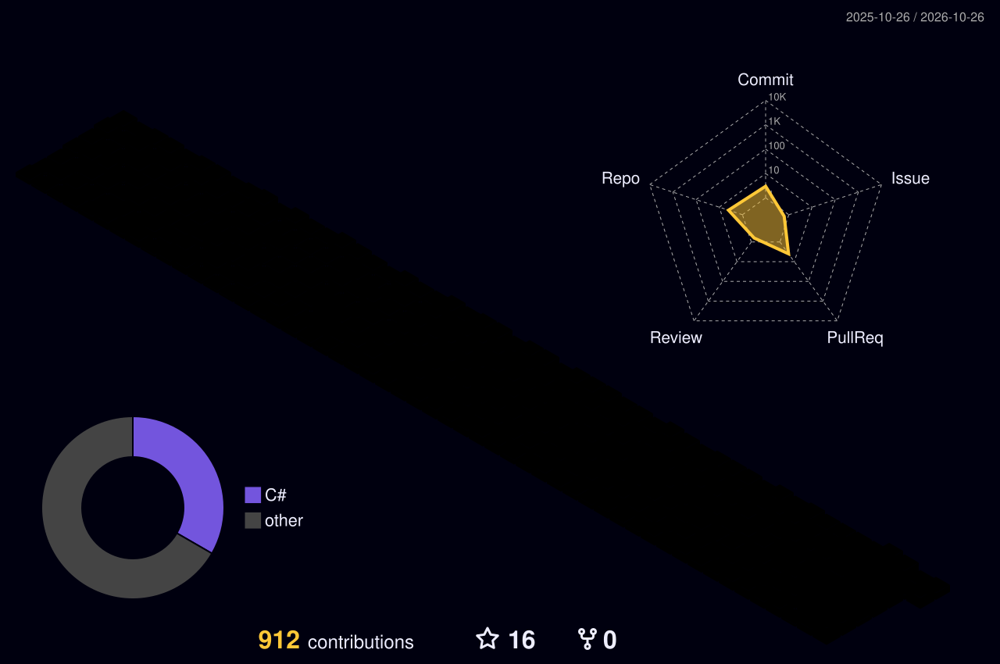

  

  
  &nbsp;
  
  &nbsp;
  
  &nbsp;
  

---

<table align="center" width="100%">
  <tr>
    <td valign="top" width="50%">

**About Me**

🎓 &nbsp;BSc in CS | Completing Master's @ **University of Leiria & West**  
🔍 &nbsp;Exploring **Reverse Engineering** with IDA Pro  
💼 &nbsp;Former intern @ **VOID Software**  
🌍 &nbsp;Based in **Portugal**  
📬 &nbsp;marco.hbzk02@gmail.com

    </td>
    <td valign="top" width="50%" align="center">
      
    </td>
  </tr>
</table>

---

<h2 align="center">📊 GitHub Stats</h2>

  
  &nbsp;&nbsp;
  

  

---

<h2 align="center">🌐 3D Contribution Map</h2>

  

---

<h2 align="center">🐍 Contribution Snake</h2>

  <picture>
    <source media="(prefers-color-scheme: dark)" srcset="https://raw.githubusercontent.com/marcohbzk/marcohbzk/output/github-contribution-grid-snake-dark.svg" />
    <source media="(prefers-color-scheme: light)" srcset="https://raw.githubusercontent.com/marcohbzk/marcohbzk/output/github-contribution-grid-snake.svg" />
    
  </picture>

---

<h2 align="center">🛠️ Tech Stack</h2>

  &nbsp;&nbsp;
  &nbsp;&nbsp;
  &nbsp;&nbsp;
  &nbsp;&nbsp;
  &nbsp;&nbsp;
  &nbsp;&nbsp;
  &nbsp;&nbsp;
  &nbsp;&nbsp;
  &nbsp;&nbsp;
  &nbsp;&nbsp;
  &nbsp;&nbsp;
  

---

