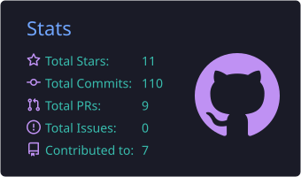
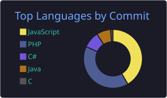
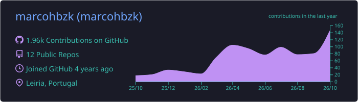

  

  
  &nbsp;
  
  &nbsp;
  

---

  🎓 &nbsp;BSc in CS | Completing Master's @ <strong>University of Leiria &amp; West</strong> 
  🔍 &nbsp;Exploring <strong>Reverse Engineering</strong> with IDA Pro &nbsp;·&nbsp; 💼 &nbsp;Former intern @ <strong>VOID Software</strong> 
  🌍 &nbsp;Portugal &nbsp;·&nbsp; 📬 &nbsp;info@hbzksolutions.com

---

<h2 align="center">📊 GitHub Stats</h2>

  

  
  

  

---

<h2 align="center">🌐 3D Contribution Map</h2>

  

---

<h2 align="center">🐍 Contribution Snake</h2>

  <picture>
    <source media="(prefers-color-scheme: dark)" srcset="https://raw.githubusercontent.com/marcohbzk/marcohbzk/output/github-contribution-grid-snake-dark.svg" />
    <source media="(prefers-color-scheme: light)" srcset="https://raw.githubusercontent.com/marcohbzk/marcohbzk/output/github-contribution-grid-snake.svg" />
    
  </picture>

---

<h2 align="center">🛠️ Tech Stack</h2>

  &nbsp;&nbsp;
  &nbsp;&nbsp;
  &nbsp;&nbsp;
  &nbsp;&nbsp;
  &nbsp;&nbsp;
  &nbsp;&nbsp;
  &nbsp;&nbsp;
  &nbsp;&nbsp;
  &nbsp;&nbsp;
  &nbsp;&nbsp;
  &nbsp;&nbsp;
  

---

